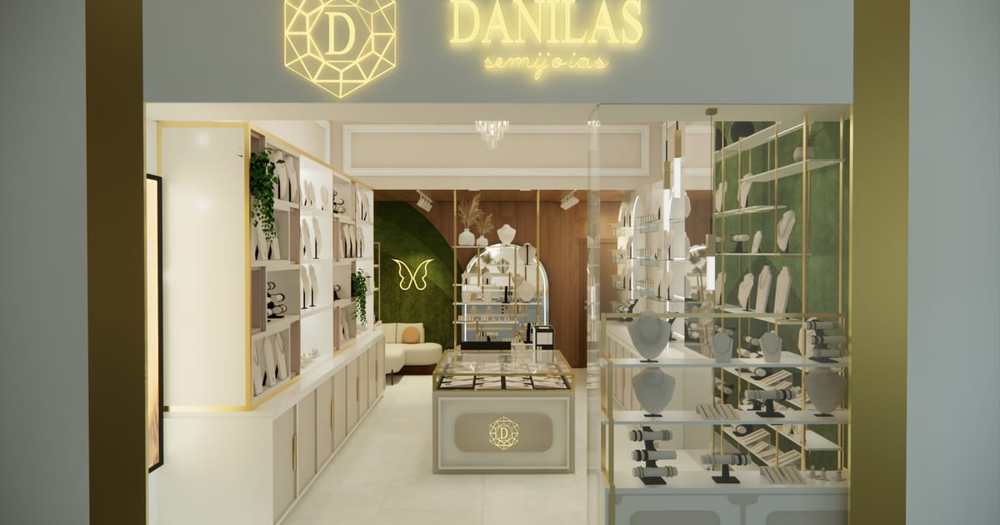

# Rafaela Ferreira · Arquitetura Comercial

**Site institucional one page** · React · TypeScript · Vite · Tailwind CSS · Framer Motion · Three.js

[](https://react.dev)
[](https://www.typescriptlang.org)
[](https://vite.dev)
[](https://tailwindcss.com)
[](https://threejs.org)
[](LICENSE)

Site institucional de uma arquiteta especializada em espaços comerciais. Uma única página que apresenta a profissional, os projetos, os serviços, o processo de trabalho e o contato, com uma identidade editorial em tons de grafite, areia e marfim.



> Projeto de portfólio, feito a partir do site atual da profissional. Textos, contatos, renders e a localização são dela e estão marcados como pendentes de confirmação antes da publicação. Este repositório não é o site oficial.

## Sobre o projeto

O ponto de partida foi tratar a arquitetura comercial como ferramenta de posicionamento de marca: cada espaço traduz uma marca em experiência. A identidade usa Cormorant Garamond nos títulos e Manrope no texto, com cantos retos, numeração editorial só onde há sequência real e movimento com propósito.

A seção **Processo** é a mais elaborada. No desktop, uma maquete 3D de estudo se monta conforme a rolagem: o espaço medido, as zonas e o percurso do cliente, as paredes e o mobiliário, o detalhamento em raio-x e, por fim, materiais e luzes. No celular e para quem prefere menos movimento, a mesma sequência aparece como prancha desenhada, sem carregar o Three.js.

## Funcionalidades

- **Abertura em três tempos**: um quadro se desenha, a imagem surge dentro dele e se expande até a tela
- **Navegação com indicador de seção**: menu que muda de cor sobre fundos escuros e menu mobile em tela cheia
- **Galeria assimétrica de projetos**: cada projeto tem proporção própria, cursor "Ver" e modal com navegação por teclado
- **Serviços em lista editorial**: ao passar o mouse, um render relacionado acompanha o cursor
- **Processo**: maquete 3D fixa com etapas que avançam pela rolagem (desktop) ou prancha por etapa (mobile)
- **Contato direto**: botão de WhatsApp com mensagem pré-preenchida e e-mail
- **Acessibilidade**: foco visível, link de pular para o conteúdo, respeito a `prefers-reduced-motion` e HTML semântico

## Stack

- React 19 e TypeScript
- Vite 8 e Tailwind CSS 4
- Framer Motion (versão enxuta, com `LazyMotion`)
- Lenis para rolagem suave
- Three.js, carregado sob demanda só na seção Processo
- Lucide React para ícones
- Sharp para gerar as imagens em AVIF e WebP

## Estrutura

```
src/
  components/   uma pasta por seção (Navbar, Hero, About, Projects, Services, Process, Contact, Footer)
  data/         site.ts, projects.ts e services.ts: conteúdo separado dos componentes
  hooks/        rolagem suave, seção ativa, media queries e seguimento do cursor
  animations/   easing e tempos de movimento compartilhados
  styles/       tokens de cor e tipografia no Tailwind
public/
  img/          renders em AVIF e WebP, em três larguras
  fonts/        Cormorant Garamond e Manrope (subconjunto latino)
scripts/
  optimize-images.mjs   gera as versões de imagem a partir de _ref/
```

## Setup local

Requer Node.js 20 ou superior.

```bash
npm install
npm run dev
```

Abra `http://localhost:5173`.

Outros comandos:

```bash
npm run build     # checagem de tipos e build de produção
npm run preview   # serve o build localmente
npm run images    # regenera AVIF e WebP (precisa dos originais em _ref/)
```

A pasta `_ref/` não é versionada, porque guarda os originais dos renders. Sem ela, o site funciona normalmente com as imagens já presentes em `public/img/`; só o `npm run images` depende dela.

## Conteúdo pendente de confirmação

Antes de publicar, estes pontos precisam ser confirmados com a profissional:

- **Localização**: o site atual indica Paulista (PE) no contato e Rio de Janeiro no rodapé. Por isso, a localização está oculta (`location.pending` em `src/data/site.ts`).
- **WhatsApp**: confirmar se o número `(81) 99546-4203` é o WhatsApp profissional.
- **Etapas do processo**: são uma sugestão, a confirmar. A última etapa está marcada como "conforme escopo contratado".
- **Redes sociais**: nenhuma foi encontrada no site atual. A lista em `site.ts` está vazia.
- **Fotos**: não há foto da profissional. Os renders dos projetos são apresentações 3D, não fotos de obras executadas.
- **Domínio**: a URL do Open Graph precisa ser absoluta quando o domínio existir.

## Autor

**João Batista Neto**
Desenvolvedor Full-stack (solo)

- GitHub: [@joaobatis1a](https://github.com/joaobatis1a)
- LinkedIn: [joao-batista-silva-neto](https://linkedin.com/in/joao-batista-silva-neto)

## Licença

Distribuído sob a licença MIT. Veja [`LICENSE`](LICENSE) para mais detalhes.
